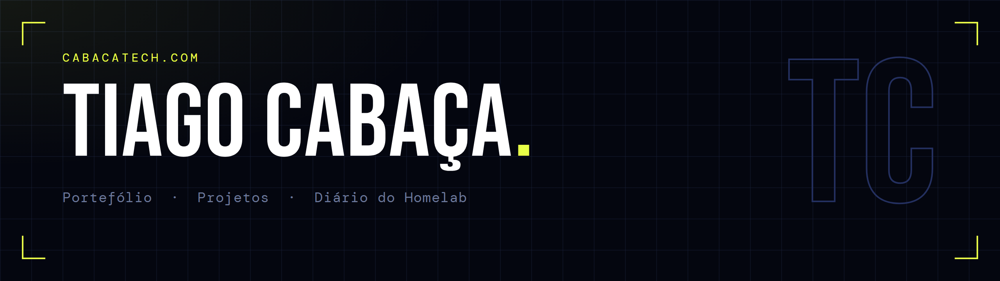
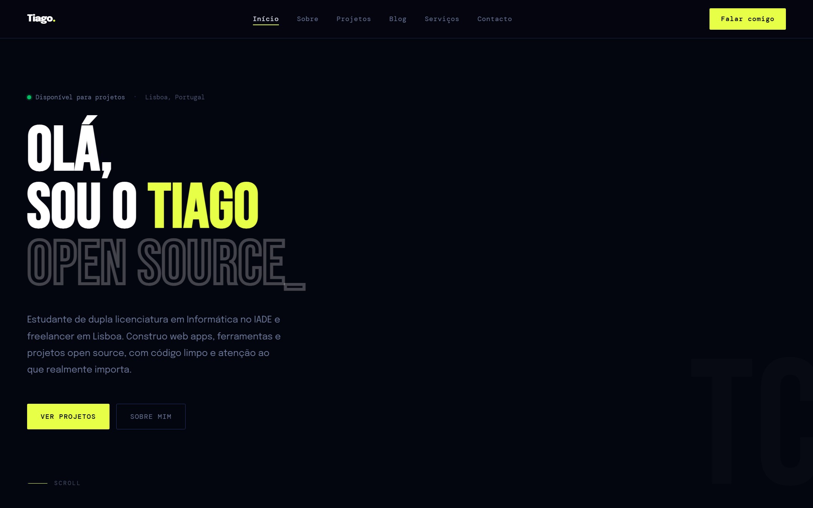
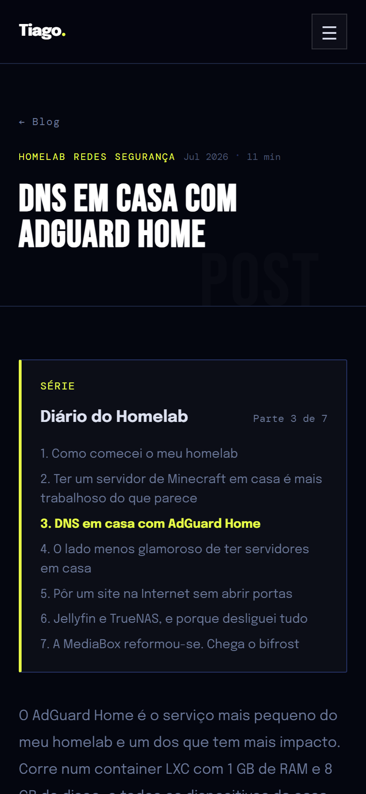

<p align="center">
  
</p>

<p align="center">
  <a href="https://cabacatech.com/"><strong>cabacatech.com</strong></a>
  &nbsp;·&nbsp; Portfolio, case studies and a technical blog, in European Portuguese
</p>

---

Source of my personal website: the projects I have built, written up as case studies, and a blog about what I learn along the way, from web development to running my own servers. It is a static site with no framework and no build step, driven by a small content engine that turns Markdown files into pages.

This repository is public so the work behind the site can be seen, not as a template to run. The content engine is free to reuse; the content and the design are personal (see [License](#license)).

<p align="center">
  
  &nbsp;
  
</p>

## How content works

Every project and blog post is a Markdown file with a frontmatter block. Two JSON files list which ones appear on the site and in what order.

```text
content/projects/<id>.md   ->  data/projects-index.json  ->  pages/project-detail.html?id=<id>
content/posts/<id>.md      ->  data/posts-index.json     ->  pages/blog-post.html?id=<id>
```

`assets/js/content-engine.js` reads the index, fetches the file, parses the frontmatter, expands the custom blocks, renders the Markdown with [marked](https://marked.js.org/) and injects the result into a shared template. Adding an entry means writing one Markdown file and adding its id to the index; no HTML or CSS changes.

### Custom blocks

On top of standard Markdown (tables, code, images), the engine understands blocks opened with `:::name` and closed with `:::`:

| Block | Renders |
|---|---|
| `callout`, `info`, `tip`, `warning`, `danger` | Highlighted notes and warnings |
| `specs` | A key and value spec sheet |
| `decision` | A technical decision set apart from the text |
| `resource` | A recommended external link with context |
| `details` | A collapsible section, closed by default |
| `timeline` | A timeline, with `horizontal`, `compact` and `grid` layouts |
| `stats` | Highlighted figures |
| `compare` | Two options side by side |
| `carousel` | An image carousel with optional captions |
| `video` | A YouTube, Vimeo or local video |
| `image-placeholder` | A reserved slot for an image still to be added |

Two frontmatter keys link content together:

- `series` and `seriesPart` group posts into a series, with a contents box at the top and previous and next links at the end.
- `related: [post:<id>, project:<id>]` picks the cards shown at the end of a page. Without it, the page shows the first entries of the index.

## Publishing

The site is served by GitHub Pages from the `main` branch, with a custom domain (`CNAME`) and `.nojekyll` so files are served as they are.

```bash
python tools/build_feeds.py   # regenerates feed.xml and sitemap.xml from the indexes
git push
```

`tools/build_feeds.py` takes the RSS dates from each post's `date` and the sitemap `lastmod` values from the last commit that touched each file, so it runs after committing the content.

## Project structure

```text
index.html                  Home
pages/                      About, projects, blog, services, uses, contact, privacy, and the two content templates
content/posts/              Blog posts (Markdown)
content/projects/           Project case studies (Markdown)
data/                       posts-index.json and projects-index.json
assets/js/content-engine.js The content engine
assets/js/script.js         Navigation, reveal animations, page interactions
assets/css/style.css        Design tokens, layout and components
assets/css/content.css      Content blocks
assets/css/responsive.css   Breakpoints
assets/css/fonts.css        Self-hosted font faces
assets/fonts/               Bebas Neue, DM Mono and Epilogue (WOFF2, with their OFL licences)
tools/build_feeds.py        Generator for the RSS feed and the sitemap
feed.xml, sitemap.xml       Generated, committed
llms.txt, robots.txt        Site summary for language models (llmstxt.org format) and crawler rules
site.webmanifest            Icons and theme colour
```

## Decisions worth knowing

**No framework, no CMS, no build.** The site is small and I wanted to understand every layer under it instead of working through abstractions. The cost is a little duplicated markup across the static pages (the header and footer are repeated in each HTML file).

**Markdown plus a JSON index.** One template per content type instead of one HTML page per entry. Content and presentation change independently.

**Animations run once.** Elements animate when they first enter the viewport and then stay still. Nothing loops or re-triggers on scroll, and `prefers-reduced-motion` shows the final state immediately.

**No cookies, no analytics.** The site stores nothing in the browser and does not track visitors, so it needs no cookie banner. The privacy page lists the external services the browser contacts.

**Self-hosted fonts.** The fonts are served from this repository instead of Google Fonts, so visitors' IP addresses are not sent to Google, and the site has one less external dependency.

**marked is pinned.** The only remote script is marked, pinned to an exact version (15.0.12) with a Subresource Integrity hash. An unpinned CDN URL can change behaviour, or break the blog, without any change in this repository.

**In-content navigation never uses `<nav>`.** The global `nav` rule styles the fixed top bar. Navigation inside content (series links) uses `<div role="navigation">` instead.

## Status

Checked on 11 October 2026.

- Live and working: home, about, projects, blog, services, uses, contact and privacy pages; 10 project case studies and 9 posts.
- The contact form is visible but disabled on purpose until it has a working backend; email works.
- Several pages still show image placeholders, which will be replaced with real photographs and screenshots.
- Content is rendered in the browser. Search engines that run JavaScript see everything; crawlers that do not see only the static pages.

## License

The repository mixes reusable code with personal material, under different terms. See [LICENSE](LICENSE) for the full text.

| Material | Terms |
|---|---|
| `assets/js/content-engine.js` and `tools/build_feeds.py` | MIT: reuse them freely, keeping the copyright notice |
| Written content, HTML pages, images, the TC mark and the visual design | All rights reserved |
| Fonts in `assets/fonts/` | SIL Open Font License 1.1 |

If you want to reuse something from the second group, ask first.

## Author

**Tiago Cabaça**, computer engineering student at IADE, Lisbon.

[cabacatech.com](https://cabacatech.com) · [GitHub](https://github.com/Cabacadosinformaticos) · [LinkedIn](https://www.linkedin.com/in/tiago-caba%C3%A7a)
